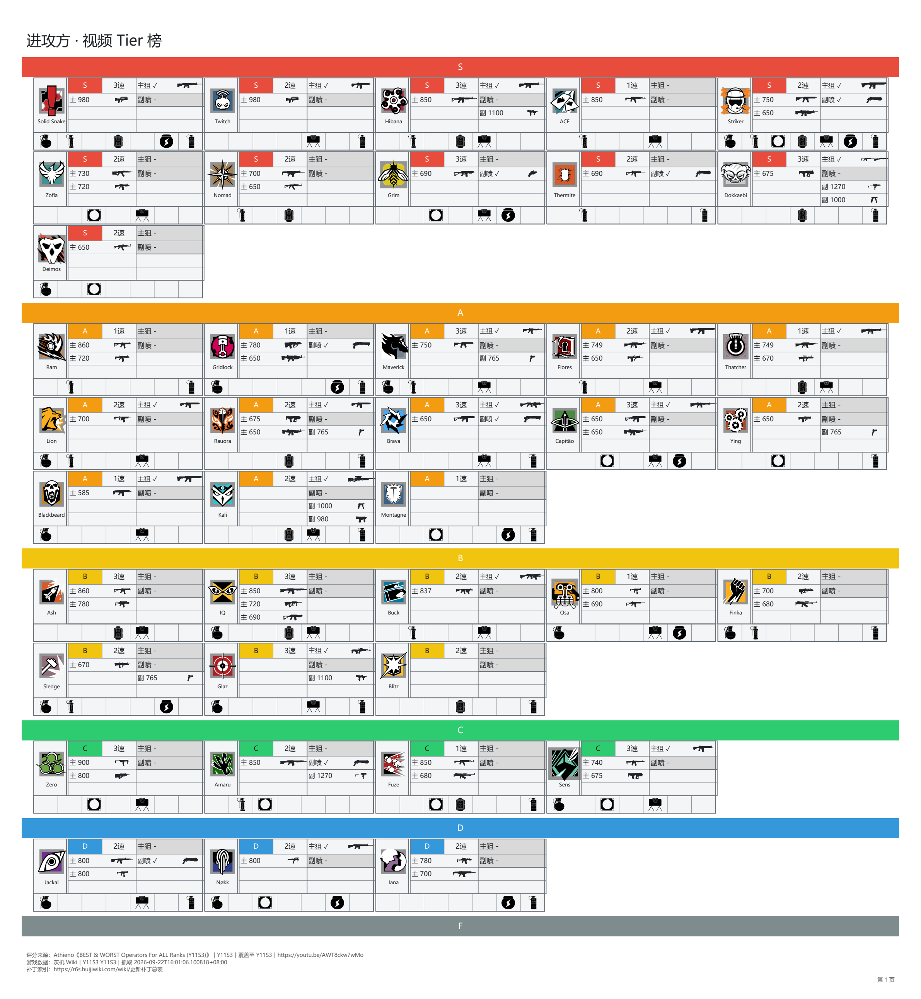
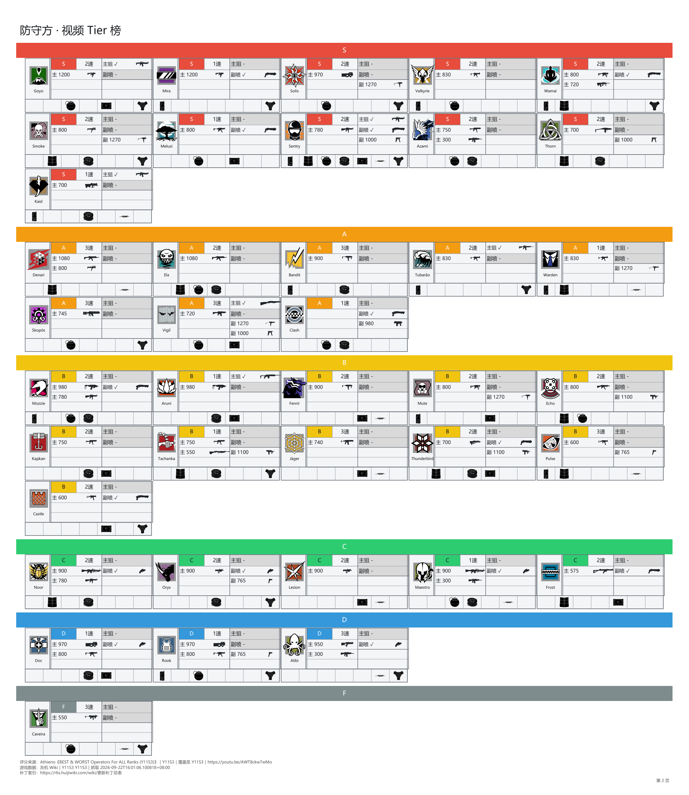
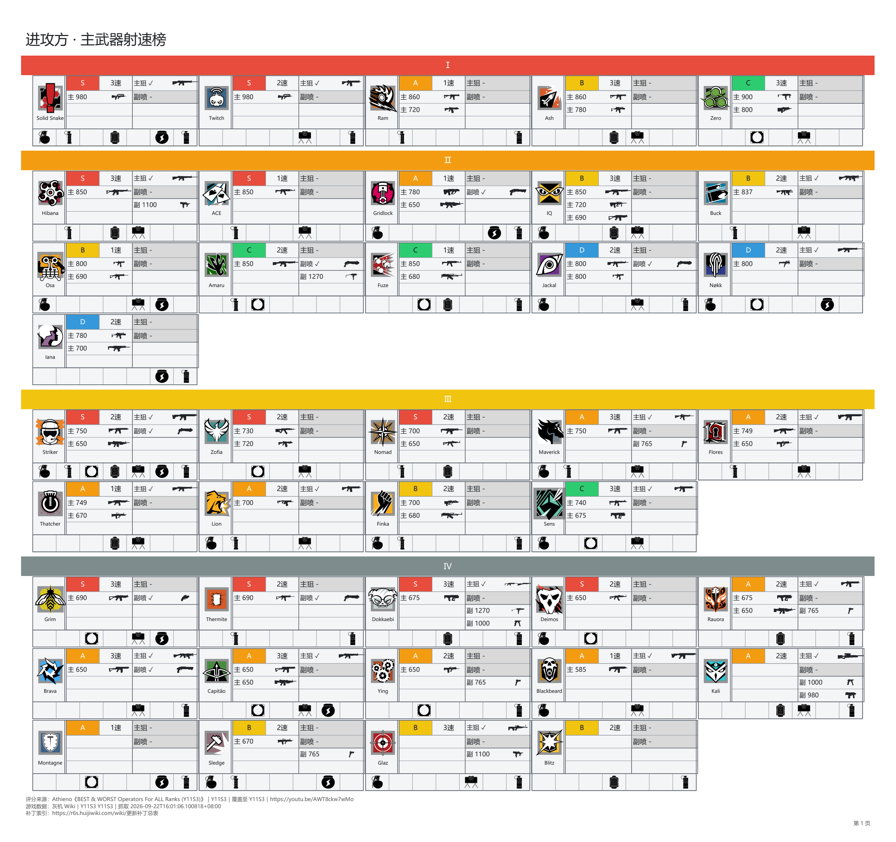
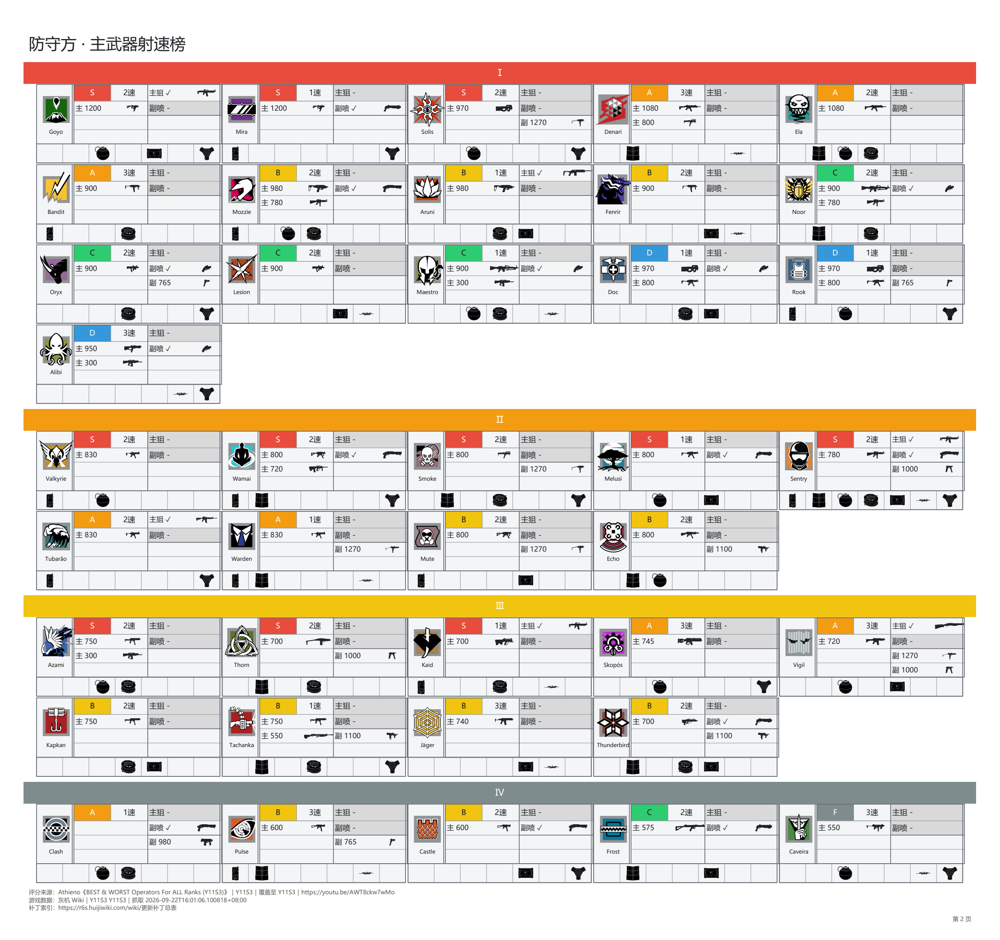
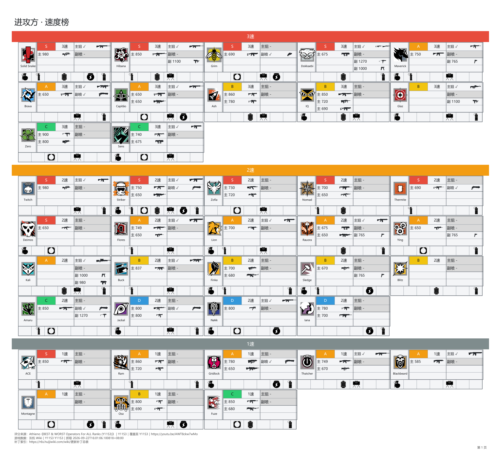
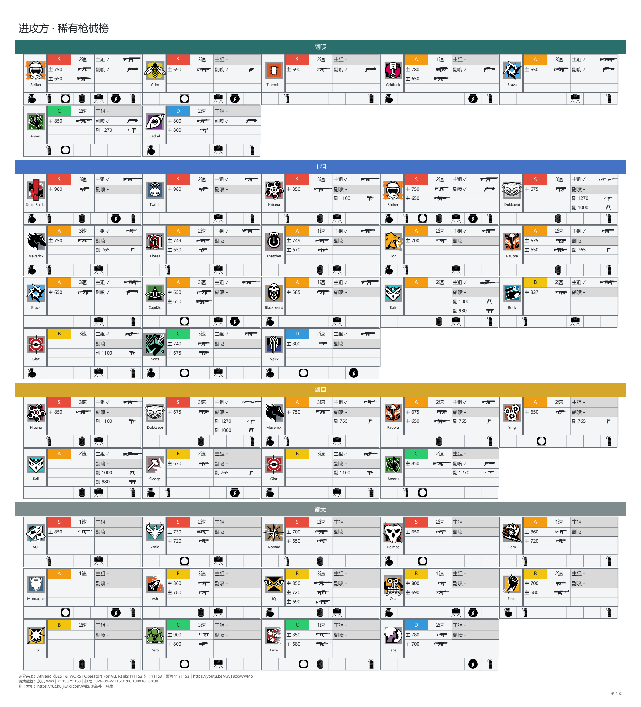
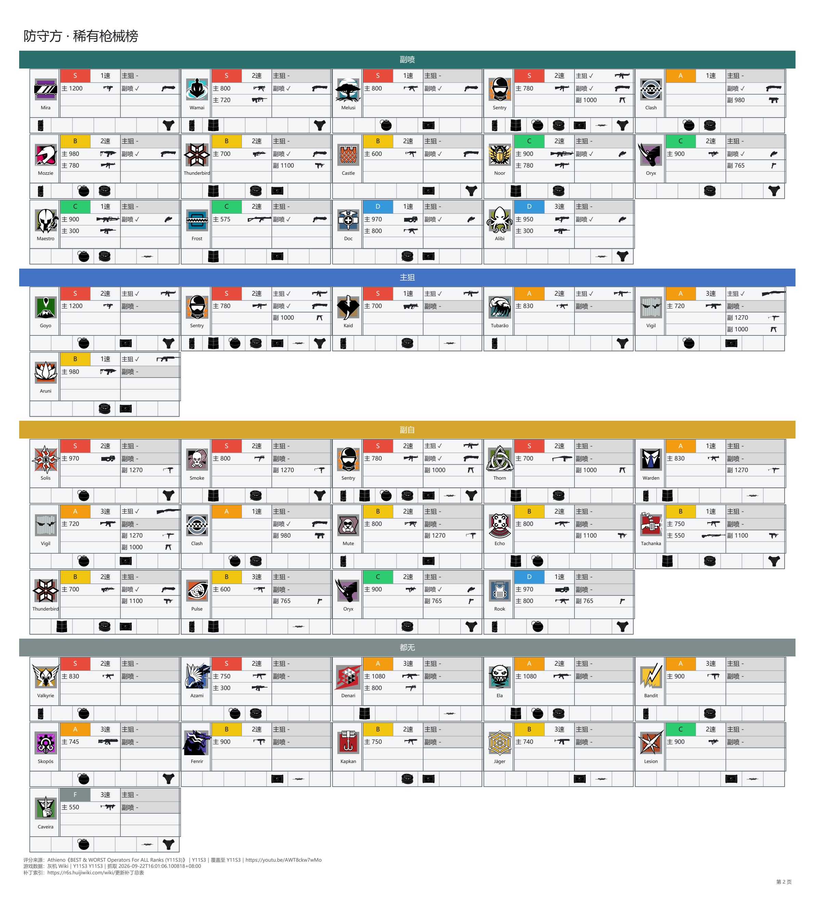

# R6 干员中文榜单 · Y11S3

<p align="center">
  <strong>把视频评分、武器数据、干员速度与装备配置，汇成一套真正方便比较的中文榜单。</strong>
</p>

<p align="center">
  
  
  
  
</p>

> **当前版本：Y11S3** · **最后更新：2026-09-22 16:01（UTC+8）**
> 评分来源：[Athieno — BEST & WORST Operators For ALL Ranks (Y11S3)](https://youtu.be/AWT8ckw7wMo)

无需打开 Excel，也能直接浏览高清 PDF 与 PNG；需要筛选、打印或二次分析时，则可使用完整 XLSX 工作簿。

## 一套数据，五种视角

| 榜单 | 适合快速回答的问题 | PDF |
|---|---|:---:|
| 视频评分榜 | 当前版本哪些干员综合评价最高？ | [打开](docs/outputs/视频评分榜.pdf) |
| 主武器射速榜 | 哪些干员拥有更高射速的主武器？ | [打开](docs/outputs/主武器射速榜.pdf) |
| 速度榜 | 同速度档内，谁的综合配置更强？ | [打开](docs/outputs/速度榜.pdf) |
| 稀有枪械榜 | 谁拥有副喷、主狙或副自动武器？ | [打开](docs/outputs/稀有枪械榜.pdf) |
| 次要装备榜 | 手雷、硬突破、遥控炸药等装备如何分布？ | [打开](docs/outputs/次要装备榜.pdf) |

所有榜单内部统一按 **视频原始分数 → 最高主武器射速 → 干员速度 → 稀有枪械 → 次要装备** 的多级优先级排序。

## 功能亮点

- 将 Athieno 人工核对的干员 Tier 与灰机 Wiki 当前数据合并。
- 原子采集 Wiki 表格、干员图标、枪械图标、次要装备图标及视频评分日期之后的补丁；采集失败时保留上一份有效快照。
- 生成视频评分、主武器射速、速度、稀有枪械、次要装备五种中文榜单。
- 每种榜单同时输出 XLSX、PDF 和逐页 PNG 图片版：
  - XLSX 包含进攻方、防守方和补丁说明工作表。
  - PDF 固定为进攻方、防守方、补丁说明三页；每页保持 420 mm 宽并按实际内容自动调整高度，章节不会自动换页。
  - PNG 图片版按 PDF 原页直接以 144 DPI 栅格化，不裁剪、不重排、不拼接，保存在 `~outputs/图片版/<榜单名>/`。
- 等级使用整行色带；卡片左侧在同一徽章框内显示完整尺寸的干员图标，并在图标下方单行显示干员名字。前四行统一按左右半区对齐：顶部左半区再等分为带颜色的视频 Tier 和速度，右半区显示主狙，下面三行逐行显示主要武器及副喷/副武器；副喷下方仅在右半区使用强调线，深灰实线同时清晰划分外框、中央分区、各行及底部七个次要装备槽。
- 报告附带评分来源、Wiki 快照信息和补丁覆盖区间。
- PDF 由 ReportLab 直接生成，不依赖 Microsoft Excel 或 LibreOffice。

### 报告预览

#### 视频评分榜

[打开 PDF 报告](docs/outputs/视频评分榜.pdf)

| 进攻方 | 防守方 |
|:---:|:---:|
|  |  |

#### 主武器射速榜

[打开 PDF 报告](docs/outputs/主武器射速榜.pdf)

| 进攻方 | 防守方 |
|:---:|:---:|
|  |  |

#### 速度榜

[打开 PDF 报告](docs/outputs/速度榜.pdf)

| 进攻方 | 防守方 |
|:---:|:---:|
|  |  |

#### 稀有枪械榜

[打开 PDF 报告](docs/outputs/稀有枪械榜.pdf)

| 进攻方 | 防守方 |
|:---:|:---:|
|  |  |

#### 次要装备榜

[打开 PDF 报告](docs/outputs/次要装备榜.pdf)

| 进攻方 | 防守方 |
|:---:|:---:|
|  |  |

## 本地部署

环境要求：

- Windows
- Python 3.9+
- `curl.exe`
- 无需安装 Microsoft Excel 或 LibreOffice

### 1. 安装依赖

在 PowerShell 中进入项目目录，创建虚拟环境并安装依赖：

```powershell
cd r6_num
python -m venv .venv
.\.venv\Scripts\Activate.ps1
python -m pip install --upgrade pip
python -m pip install -r requirements.txt
```

### 2. 获取最新 Athieno Tier

在 Codex 中打开本项目并输入：

```text
$build-r6-operator-report 获取最新 Athieno 干员 Tier
```

### 3. 生成报表

运行完整采集与报表生成流程：

```powershell
.\run_r6_report.bat
```

如需使用现有 `inputs/` 快照重新生成榜单，不重新联网采集：

```powershell
$env:PYTHONPATH='src'
$env:PYTHONUTF8='1'
python -m r6_report.operator_stats `
  --inputs-dir inputs `
  --output '~temp/r6_operator_stats.xlsx'
python -m r6_report.leaderboards `
  --inputs-dir inputs `
  --input '~temp/r6_operator_stats.xlsx' `
  --output-dir '~outputs'
```

### 4. 验证

验证本地部署：

```powershell
$env:PYTHONPATH='src'
$env:PYTHONUTF8='1'
python -m unittest discover -s tests -v
```

### 生成文件

```text
~outputs/
  视频评分榜.xlsx
  视频评分榜.pdf
  主武器射速榜.xlsx
  主武器射速榜.pdf
  速度榜.xlsx
  速度榜.pdf
  稀有枪械榜.xlsx
  稀有枪械榜.pdf
  次要装备榜.xlsx
  次要装备榜.pdf
  图片版/
    视频评分榜/
      第1页.png
      第2页.png
      第3页.png
    主武器射速榜/
    速度榜/
    稀有枪械榜/
    次要装备榜/
```

## 参考链接与相关网站

### 评分与数据来源

- [Athieno：BEST & WORST Operators For ALL Ranks (Y11S3)](https://youtu.be/AWT8ckw7wMo) — 本版本视频 Tier 评分来源。
- [彩虹六号：围攻灰机 Wiki](https://r6s.huijiwiki.com/) — 干员、武器、配装与补丁数据来源。
- [干员数据表](https://r6s.huijiwiki.com/wiki/Data:Operator.tabx)
- [武器数据表](https://r6s.huijiwiki.com/wiki/Data:WeaponData.tabx)
- [武器配置表](https://r6s.huijiwiki.com/wiki/Data:WeaponConfig.tabx)
- [更新补丁总表](https://r6s.huijiwiki.com/wiki/更新补丁总表)

### 官方与项目网站

- [Rainbow Six Siege 官方网站](https://www.ubisoft.com/en-us/game/rainbow-six/siege)
- [Rainbow Six Siege 赛季信息](https://www.ubisoft.com/en-us/game/rainbow-six/siege/news-updates/seasons)
- [本项目 GitHub 仓库](https://github.com/adadsws/r6s-stats-tiers)

> 本项目是社区制作的数据整理与报表生成工具，与 Ubisoft、Athieno 或灰机 Wiki 无隶属关系；相关名称、商标及原始资料归各自权利方所有。
