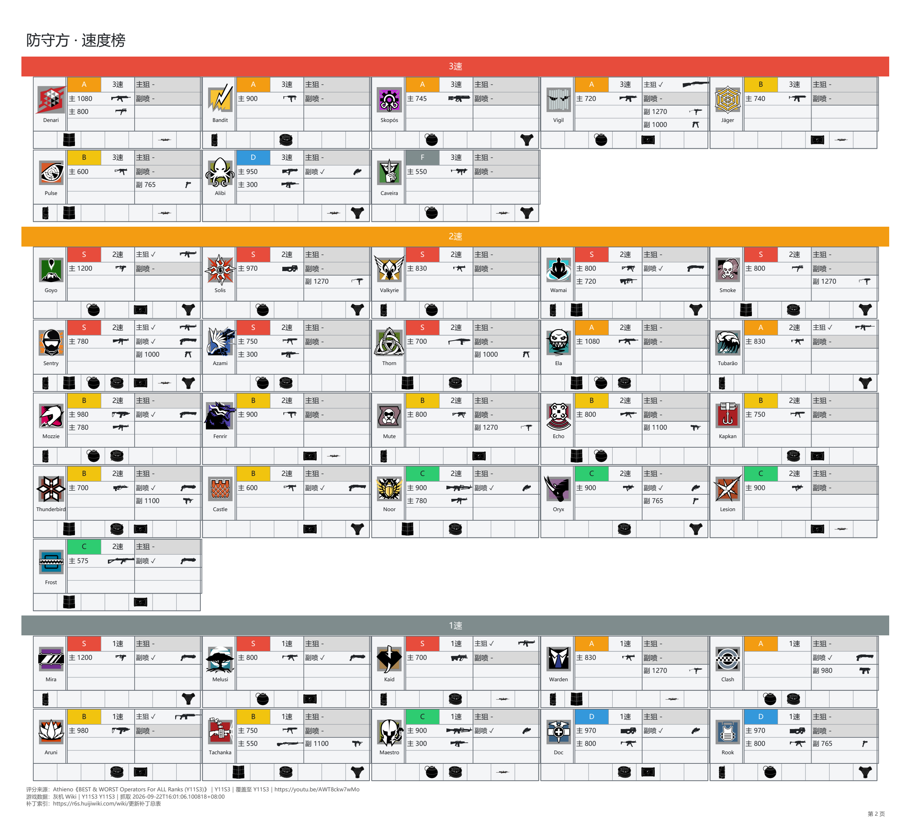
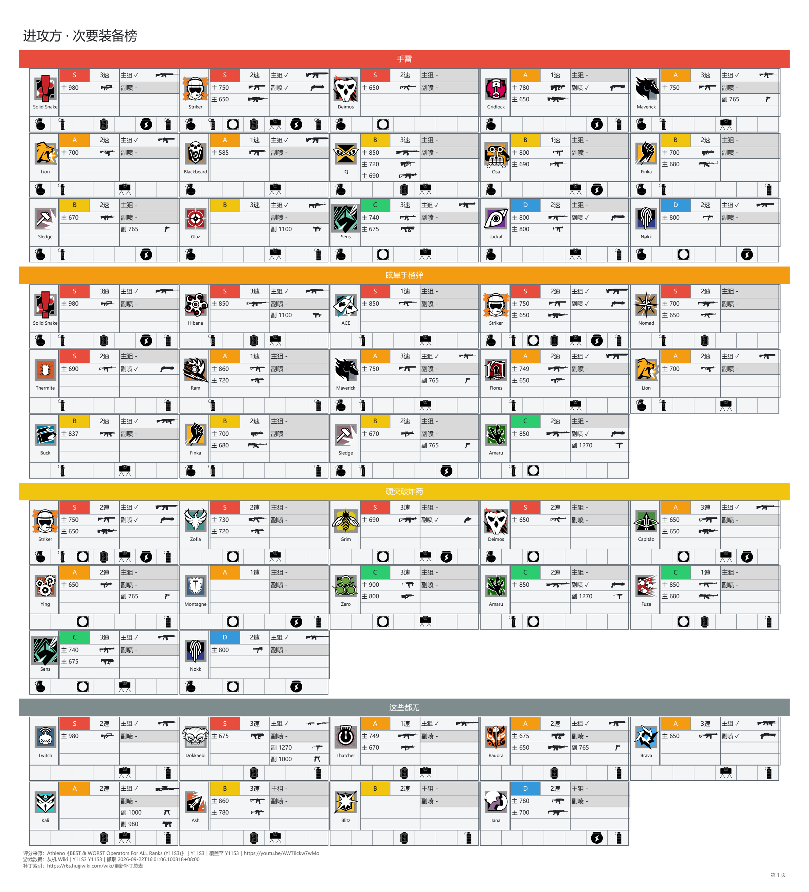
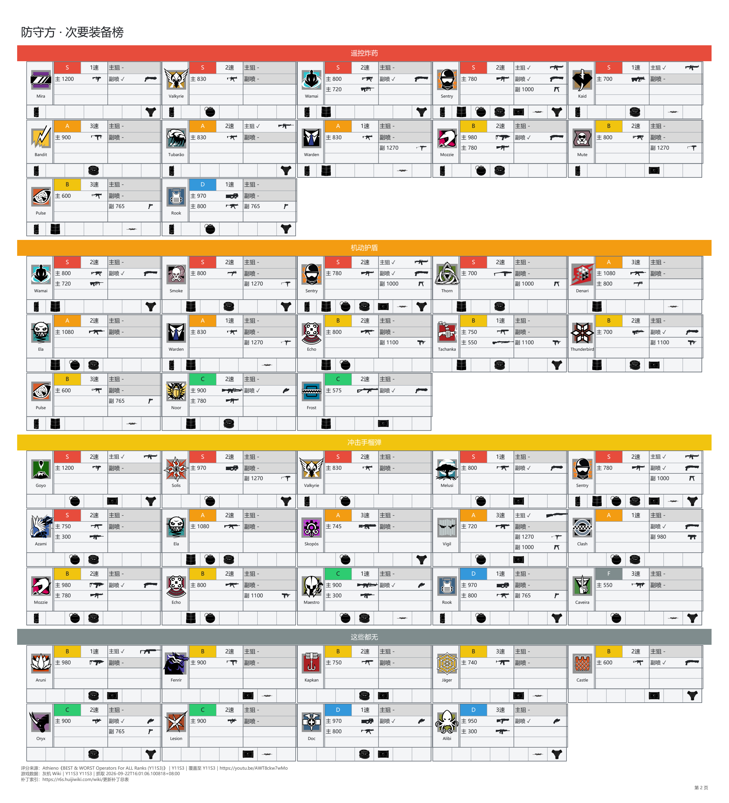

# R6 干员中文榜单 · Y11S3

<p align="center">
  <strong>把视频评分、武器数据、干员速度与装备配置，汇成一套真正方便比较的中文榜单。</strong>
</p>

<p align="center">
  
  
  
  
</p>

> **当前版本：Y11S3** · **最后更新：2026-09-22 16:01（UTC+8）**
> 评分来源：[Athieno — BEST & WORST Operators For ALL Ranks (Y11S3)](https://youtu.be/AWT8ckw7wMo)

无需打开 Excel，也能直接浏览高清 PDF 与 PNG；需要筛选、打印或二次分析时，则可使用完整 XLSX 工作簿。

## 一套数据，五种视角

| 榜单 | 适合快速回答的问题 | PDF |
|---|---|:---:|
| 视频评分榜 | 当前版本哪些干员综合评价最高？ | [打开](docs/outputs/视频评分榜.pdf) |
| 主武器射速榜 | 哪些干员拥有更高射速的主武器？ | [打开](docs/outputs/主武器射速榜.pdf) |
| 速度榜 | 同速度档内，谁的综合配置更强？ | [打开](docs/outputs/速度榜.pdf) |
| 稀有枪械榜 | 谁拥有副喷、主狙或副自动武器？ | [打开](docs/outputs/稀有枪械榜.pdf) |
| 次要装备榜 | 手雷、硬突破、遥控炸药等装备如何分布？ | [打开](docs/outputs/次要装备榜.pdf) |

所有榜单内部统一按 **视频原始分数 → 最高主武器射速 → 干员速度 → 稀有枪械 → 次要装备** 的多级优先级排序。

## 报告预览

#### 视频评分榜

[打开 PDF 报告](docs/outputs/视频评分榜.pdf)

| 进攻方 | 防守方 |
|:---:|:---:|
|  |  |

#### 主武器射速榜

[打开 PDF 报告](docs/outputs/主武器射速榜.pdf)

| 进攻方 | 防守方 |
|:---:|:---:|
|  |  |

#### 速度榜

[打开 PDF 报告](docs/outputs/速度榜.pdf)

| 进攻方 | 防守方 |
|:---:|:---:|
|  |  |

#### 稀有枪械榜

[打开 PDF 报告](docs/outputs/稀有枪械榜.pdf)

| 进攻方 | 防守方 |
|:---:|:---:|
|  |  |

#### 次要装备榜

[打开 PDF 报告](docs/outputs/次要装备榜.pdf)

| 进攻方 | 防守方 |
|:---:|:---:|
|  |  |

## 下载与更新

如果只是查看榜单、获取最新榜单或更新本地文件，无需部署项目，也不要运行重建脚本；直接下载
`docs/outputs/` 中的新版文件并覆盖旧版即可：

| 榜单 | XLSX | PDF | 图片版 |
|---|:---:|:---:|:---:|
| 视频评分榜 | [下载](docs/outputs/视频评分榜.xlsx) | [下载](docs/outputs/视频评分榜.pdf) | [查看](docs/outputs/图片版/视频评分榜/) |
| 主武器射速榜 | [下载](docs/outputs/主武器射速榜.xlsx) | [下载](docs/outputs/主武器射速榜.pdf) | [查看](docs/outputs/图片版/主武器射速榜/) |
| 速度榜 | [下载](docs/outputs/速度榜.xlsx) | [下载](docs/outputs/速度榜.pdf) | [查看](docs/outputs/图片版/速度榜/) |
| 稀有枪械榜 | [下载](docs/outputs/稀有枪械榜.xlsx) | [下载](docs/outputs/稀有枪械榜.pdf) | [查看](docs/outputs/图片版/稀有枪械榜/) |
| 次要装备榜 | [下载](docs/outputs/次要装备榜.xlsx) | [下载](docs/outputs/次要装备榜.pdf) | [查看](docs/outputs/图片版/次要装备榜/) |

### 重建榜单（仅开发和数据更新时使用）

只有需要自行采集最新数据、修改规则或重新生成报表时，才需要配置本地环境并运行
`src/rebuild_leaderboards.bat`。普通使用直接下载上方文档即可。

环境要求：

- Windows
- Python 3.9+
- `curl.exe`
- 无需安装 Microsoft Excel 或 LibreOffice

### 1. 安装依赖

在 PowerShell 中进入项目目录，创建虚拟环境并安装依赖：

```powershell
cd r6_num
python -m venv .venv
.\.venv\Scripts\Activate.ps1
python -m pip install --upgrade pip
python -m pip install -r requirements.txt
```

### 2. 获取最新 Athieno Tier

在 Codex 中打开本项目并输入：

```text
$build-r6-operator-report 获取最新 Athieno 干员 Tier
```

### 3. 生成报表

仅在需要重建榜单时运行完整采集与报表生成流程：

```powershell
.\src\rebuild_leaderboards.bat
```

如需使用现有 `data/` 快照重新生成榜单，不重新联网采集：

```powershell
$env:PYTHONPATH='src'
$env:PYTHONUTF8='1'
python -m r6_report.operator_stats `
  --data-dir data `
  --output '~temp/r6_operator_stats.xlsx'
python -m r6_report.leaderboards `
  --data-dir data `
  --input '~temp/r6_operator_stats.xlsx' `
  --output-dir '~outputs'
```

### 4. 验证

验证本地生成环境：

```powershell
$env:PYTHONPATH='src'
$env:PYTHONUTF8='1'
python -m unittest discover -s tests -v
```

### 生成文件

```text
~outputs/
  视频评分榜.xlsx
  视频评分榜.pdf
  主武器射速榜.xlsx
  主武器射速榜.pdf
  速度榜.xlsx
  速度榜.pdf
  稀有枪械榜.xlsx
  稀有枪械榜.pdf
  次要装备榜.xlsx
  次要装备榜.pdf
  图片版/
    视频评分榜/
      第1页.png
      第2页.png
      第3页.png
    主武器射速榜/
    速度榜/
    稀有枪械榜/
    次要装备榜/
```

## 参考链接与相关网站

### 评分与数据来源

- [Athieno：BEST & WORST Operators For ALL Ranks (Y11S3)](https://youtu.be/AWT8ckw7wMo) — 本版本视频 Tier 评分来源。
- [彩虹六号：围攻灰机 Wiki](https://r6s.huijiwiki.com/) — 干员、武器、配装与补丁数据来源。
- [干员数据表](https://r6s.huijiwiki.com/wiki/Data:Operator.tabx)
- [武器数据表](https://r6s.huijiwiki.com/wiki/Data:WeaponData.tabx)
- [武器配置表](https://r6s.huijiwiki.com/wiki/Data:WeaponConfig.tabx)
- [更新补丁总表](https://r6s.huijiwiki.com/wiki/更新补丁总表)

### 官方与项目网站

- [Rainbow Six Siege 官方网站](https://www.ubisoft.com/en-us/game/rainbow-six/siege)
- [Rainbow Six Siege 赛季信息](https://www.ubisoft.com/en-us/game/rainbow-six/siege/news-updates/seasons)
- [本项目 GitHub 仓库](https://github.com/adadsws/r6s-stats-tiers)

> 本项目是社区制作的数据整理与报表生成工具，与 Ubisoft、Athieno 或灰机 Wiki 无隶属关系；相关名称、商标及原始资料归各自权利方所有。
